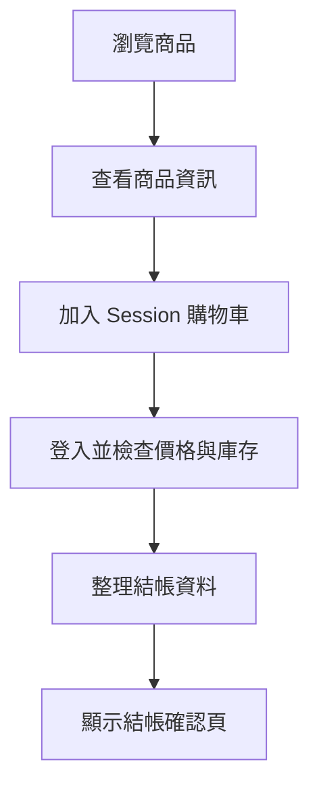
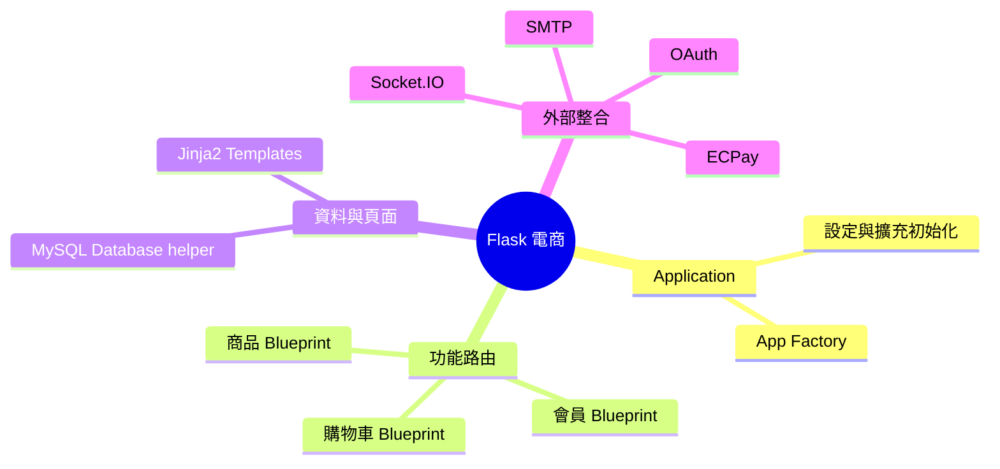

# Flask 電商網站

提供商品瀏覽、會員驗證、Session 購物車與結帳資料整理。

## 購物與結帳流程

## 架構心智圖

## 設計與技術

- **分層方式：** App Factory 負責組裝應用；Blueprint 依商品、會員與購物車拆分路由；Database helper 封裝 MySQL 存取。
- **技術：** Python 3.11、Flask 3、MySQL、Jinja2、Flask-SocketIO、OAuth、ECPay。
- **實作範圍：** 訂單寫入與扣庫存程式段落目前為註解；流程圖止於結帳確認頁。
