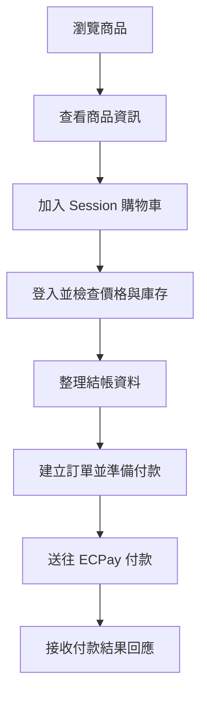

# Flask 電商網站

以商品瀏覽、會員驗證、Session 購物車與 ECPay 付款回應為核心，整理電商網站的購物與結帳流程。應用程式以 App Factory 組裝功能模組，讓路由、資料存取與頁面呈現各自維護。

## 購物流程

## 程式架構

- **App Factory：**建立 Flask 應用、載入設定並初始化擴充元件。
- **Blueprints：**依商品、會員、購物車等功能拆分路由。
- **Database helper：**封裝 MySQL 資料存取。
- **Jinja2 templates：**呈現商品、會員與結帳頁面。
- **外部功能：**OAuth 登入、SMTP 郵件、Flask-SocketIO、ECPay。

## 技術與實作範圍

- **技術：** Python 3.11、Flask 3、MySQL、Jinja2、Flask-SocketIO、OAuth、SMTP、ECPay、Docker、Gunicorn。
- **付款流程：**程式包含 ECPay 付款請求與結果回應處理，並會建立訂單記錄；付款回傳後的商品庫存扣減尚未啟用，因此不把庫存管理描述為完整閉環。
