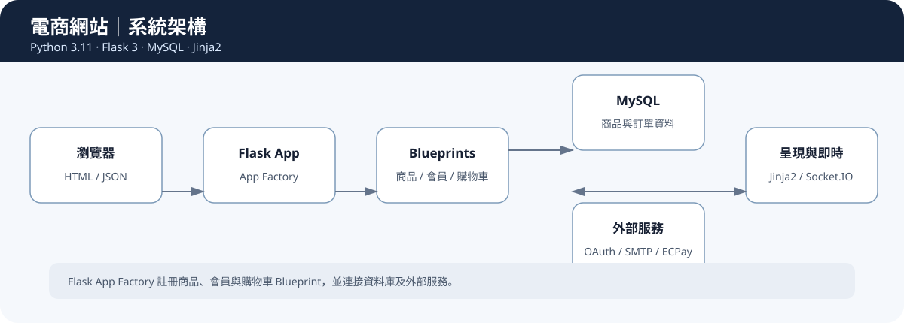
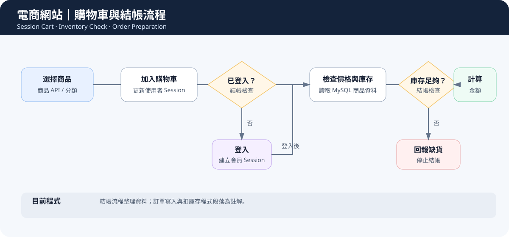

# Flask 電商網站

**技術：** Python 3.11、Flask 3、MySQL、Jinja2、Flask-SocketIO、OAuth、ECPay。

## 專案目的與範圍

提供商品瀏覽、會員驗證、Session 購物車及結帳資料整理，並整合 OAuth、SMTP 與 ECPay。現有程式中的訂單寫入與扣庫存段落為註解。

## 架構分層

- **App Factory**：載入設定、初始化擴充與註冊 Blueprint。
- **Blueprints**：依商品、會員與購物車功能拆分路由。
- **Database helper**：MySQL 查詢與更新。
- **Templates / Integrations**：Jinja2 頁面及 OAuth、SMTP、ECPay、Socket.IO 整合。

## 購物與結帳流程

[架構細節](docs/architecture.md) · [流程說明](docs/workflow.md)

## 後續優化方向（設計建議）

- 在單一資料庫交易內重新確認價格與庫存，再建立訂單並扣減庫存。
- 付款回呼加入簽章驗證、狀態檢查與冪等處理；目前訂單寫入與扣庫存程式段落為註解。

English: A Flask e-commerce application with product browsing, authentication, session cart, and checkout preparation.
