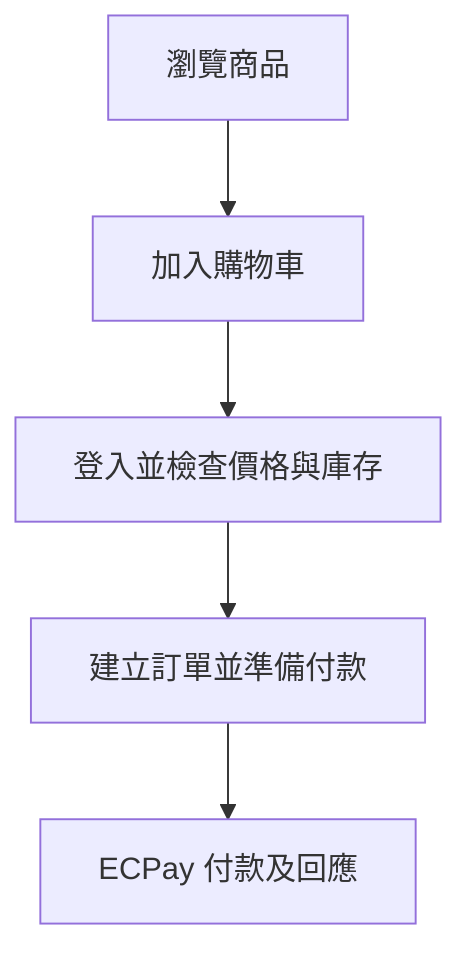
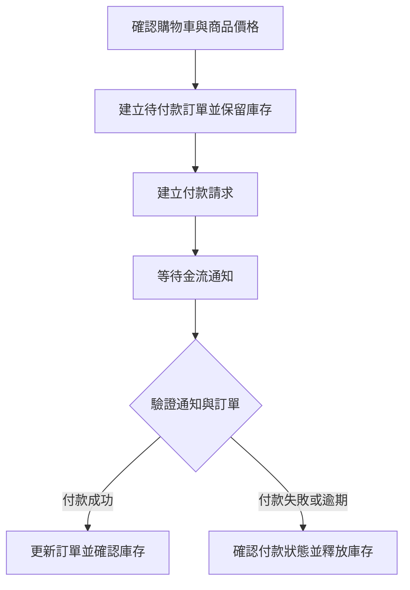

# Flask 電商網站

個人開發的小型電商作品，涵蓋商品瀏覽、會員、購物車、訂單與 ECPay 付款回應。

## 購物流程

## 程式架構

以 App Factory 初始化應用，透過 Blueprint 分組功能路由，並以資料存取工具處理 MySQL 操作。

## 實作範圍

程式包含訂單建立及付款回應處理；付款後的庫存扣減尚未啟用。

**技術：**Python、Flask、MySQL、Jinja2、OAuth、ECPay、Docker、Gunicorn。

## 庫存與金流設計

原作品已包含訂單建立與付款回應處理；以下是依小型電商情境整理的**延伸設計**，用來說明正式結帳時需要處理的問題。

### 結帳流程

付款成功以經驗證的金流通知或查詢結果為依據；逾期時先確認付款狀態，避免付款與釋放庫存同時發生。實際例外情況依金流介接規格處理。

### 設計考量

- **庫存一致性：**在資料庫交易內建立訂單並保留庫存，以條件更新檢查可用數量；付款失敗或訂單逾期時，經狀態確認後釋放保留量。
- **冪等：**建立訂單時使用請求識別，付款通知以交易識別及訂單狀態防止重複處理；訂單狀態更新與通知記錄應在同一交易中完成。
- **金流驗證：**驗證通知來源與簽章，核對訂單、金額及付款狀態；不能只依賴瀏覽器返回頁面判定付款成功。
- **流量控制：**依使用者及操作設定限流，保護結帳與付款入口；實際門檻需依流量與系統容量調整。
- **非同步處理：**通知、報表等非同步工作可由佇列處理尖峰；訂單與庫存的正確性仍由資料庫交易及狀態檢查保障。

以上為架構設計方向；原作品尚未完整實作庫存保留、冪等與非同步處理。
