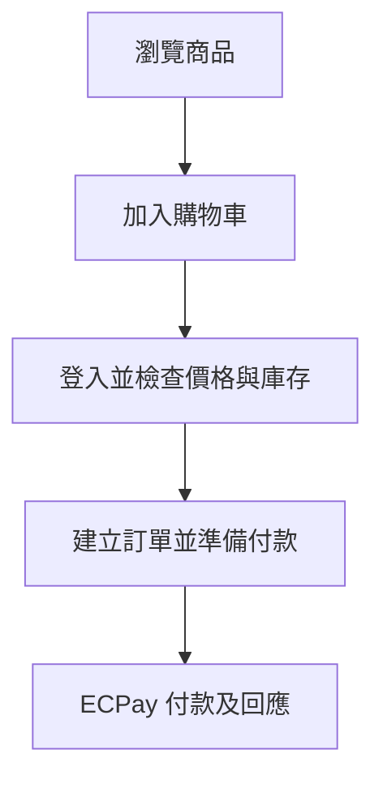

# Flask 電商網站

個人開發的小型電商作品，涵蓋商品瀏覽、會員、購物車、訂單與 ECPay 付款回應。

## 購物流程

## 程式架構

以 App Factory 初始化應用，透過 Blueprint 分組功能路由，並以資料存取工具處理 MySQL 操作。

## 實作範圍

程式包含訂單建立及付款回應處理；付款後的庫存扣減尚未啟用。

**技術：**Python、Flask、MySQL、Jinja2、OAuth、ECPay、Docker、Gunicorn。

## 程式分層

[查看購物車與付款程式架構](review-draft/)
