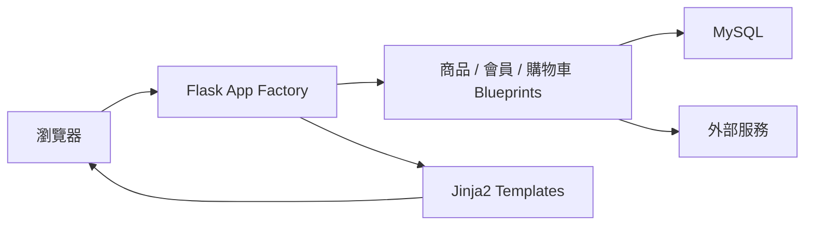

# 電商網站架構

## 技術堆疊

Python 3.11、Flask 3、MySQL、Jinja2、Flask-SocketIO、OAuth、ECPay。

## 元件分工

| 元件 | 責任 |
|---|---|
| App Factory | 載入設定、初始化擴充與註冊 Blueprint |
| Blueprint | 商品、會員與購物車路由 |
| Database helper | MySQL 查詢與更新 |
| Templates | Jinja2 頁面呈現 |
| 外部整合 | OAuth、SMTP、ECPay、Socket.IO |

